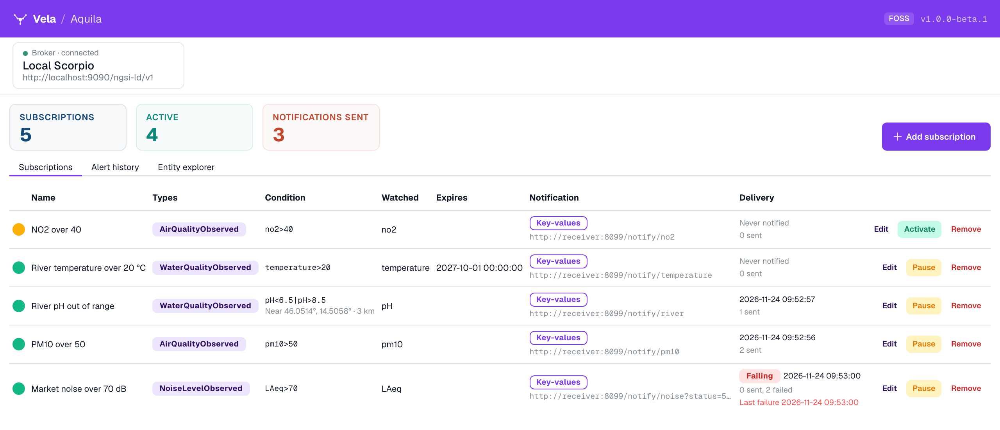

<p align="center">
  
</p>

<h1 align="center">Aquila</h1>

<p align="center">
  <strong>Alerts for <a href="https://ngsi-ld.org/">NGSI-LD</a> context brokers.</strong><br>
  Define a condition once, and the broker notifies a URI every time an entity meets it.
</p>

<p align="center">
  <a href="#quick-start">Quick start</a> ·
  <a href="https://vela-tools.github.io/aquila/">Documentation</a> ·
  <a href="#editions">Editions</a> ·
  <a href="#sovereignty">Sovereignty</a> ·
  <a href="#community">Community</a> ·
  <a href="#license">License</a>
</p>

<p align="center">
  <a href="https://github.com/vela-tools/aquila/actions/workflows/format.yaml"></a>
  <a href="https://github.com/vela-tools/aquila/actions/workflows/lint.yaml"></a>
  <a href="https://github.com/vela-tools/aquila/actions/workflows/test.yaml"></a>
  <a href="https://github.com/vela-tools/aquila/actions/workflows/dependencies.yaml"></a>
  <a href="LICENSE.md"></a>
  
</p>

<p align="center">
  <sub>Part of <a href="https://github.com/vela-tools">Vela Tools</a> · Based on EU open standards 🇪🇺 · Built in Ljubljana, Slovenia 🇸🇮 by SenLab d.o.o.</sub>
</p>

<p align="center">
  
</p>

---

> [!WARNING]
> Aquila is in beta. It has been tested against the Scorpio broker only, it has no logins of its own, and alert history does not show notifications of new subscriptions yet. Read the [known limitations](https://vela-tools.github.io/aquila/docs/known-limitations) before you rely on it.

## How it works

Aquila is a web application for the subscriptions of an NGSI-LD context broker. You describe what to watch, such as "notify `http://example.org/notify` when `pH > 8.5` on `WaterQualityObserved` inside this circle", and Aquila creates the subscription on the broker. From then on the broker itself sends a notification to that URI whenever an entity matches. Aquila shows which subscriptions exist, whether their notifications are delivered, and lets you edit, pause, resume and delete them.

Aquila has no backend and no database. It runs in the browser and talks to the brokers you add, which store the subscriptions. It does not receive the notifications, and it does not store or forward context data.

## Quick start

Run the container image, pointed at your broker:

```sh
docker run --rm -p 2361:2361 \
  -e AQUILA_BROKER_URL=https://broker.example.com/ngsi-ld/v1 \
  -e AQUILA_BROKER_NAME="My broker" \
  ghcr.io/vela-tools/aquila:latest
```

Open http://localhost:2361. The broker must allow Aquila's origin in its CORS settings, as [What the broker needs](https://vela-tools.github.io/aquila/docs/deployment#what-the-broker-needs) describes. More brokers can be added in the app, from the broker button in the header.

Every image is signed and carries a build provenance attestation. Verify them with:

```sh
cosign verify ghcr.io/vela-tools/aquila:latest \
  --certificate-identity-regexp '^https://github.com/vela-tools/aquila/' \
  --certificate-oidc-issuer https://token.actions.githubusercontent.com
gh attestation verify oci://ghcr.io/vela-tools/aquila:latest --repo vela-tools/aquila
```

To try Aquila without a broker of your own, start it with a Scorpio broker and a notification receiver. All you need is git and Docker with Compose:

```sh
git clone https://github.com/vela-tools/aquila.git
cd aquila/docker
docker compose --profile app up -d --build
```

Open http://localhost:2362. The broker in the header shows as connected once Scorpio has started, which takes about a minute.

Put two air quality stations on the broker:

```sh
curl -sS -X POST http://localhost:9090/ngsi-ld/v1/entityOperations/create \
  -H 'Content-Type: application/json' \
  -d '[
    {"id": "urn:ngsi-ld:AirQualityObserved:station-1", "type": "AirQualityObserved",
     "pm10": {"type": "Property", "value": 32}},
    {"id": "urn:ngsi-ld:AirQualityObserved:station-2", "type": "AirQualityObserved",
     "pm10": {"type": "Property", "value": 41}}
  ]'
```

Reload Aquila and choose **Add subscription**. Name it `PM10 over 50`, set the notification URI to `http://receiver:8099/notify/pm10`, pick the entity type `AirQualityObserved`, add the condition `pm10` `>` `50`, and choose **Create subscription**. The broker calls the notification URI from inside the Compose network, which is why it names the `receiver` service and not `localhost`.

Now station 2 measures more than the limit:

```sh
curl -sS -X PATCH http://localhost:9090/ngsi-ld/v1/entities/urn:ngsi-ld:AirQualityObserved:station-2/attrs \
  -H 'Content-Type: application/json' \
  -d '{"pm10": {"type": "Property", "value": 64}}'
```

The broker sends a notification to the receiver, which lists it under the tag `pm10` at http://localhost:8099. In Aquila, the subscription's **Delivery** column shows the last notification, and **Notifications sent** counts it. `docker compose down -v` removes everything again.

For development, run `npm ci` and `npm run dev`, which serves Aquila at http://localhost:2361. [Deployment](https://vela-tools.github.io/aquila/docs/deployment) and [Development](docs/development.md) have the details.

Aquila supports the browsers in [Baseline Widely available](https://web.dev/baseline): Chrome, Edge, Firefox and Safari released in about the last two and a half years.

## Why?

NGSI-LD brokers can watch their own data and notify other systems when something changes, but setting that up means writing subscription documents by hand and sending them with a tool such as curl. Checking later whether a subscription still exists, still matches what it should, and still delivers its notifications means reading the broker's JSON again. Brokers also differ in what they accept: some store part of a change they reject, or ignore members the standard defines.

Aquila turns this into a form and a list. It builds valid subscriptions from what you enter, shows their state as the broker reports it, and refuses edits the broker would apply incorrectly, with the reason, instead of leaving a broken subscription behind.

## What it does

The subscription editor covers the name and description, the notification URI, one or more entity types, conditions built from attributes and operators or written as a full NGSI-LD query, a geographic circle, when to notify (on which kinds of change, with a minimum interval, or every N seconds), watched attributes, expiry, scope query, language, the notification format and payload, and advanced options such as the JSON-LD context of notifications.

The list shows every subscription on the broker with its types, condition, watched attributes, expiry, notification settings and delivery state: whether the last notification failed, when the broker last notified, and how many notifications were sent and failed. Subscriptions can be edited, paused, resumed and deleted. A subscription with a value Aquila cannot read stays in the list, marked with what could not be read, and those fields are locked in the editor. After an edit the broker rejects, Aquila reads the subscription again, since the broker may have applied part of the change.

The entity explorer browses entity types, entities and their attributes, and starts a subscription from any attribute. The configuration of the container is read when it starts, so one image serves any broker.

## Documentation

The [documentation](https://vela-tools.github.io/aquila/) covers running Aquila, every screen, the NGSI-LD subscription members it supports, the known limitations and the roadmap. More product information is available at [velacontext.com](https://velacontext.com).

## Editions

Aquila is open core. This repository contains the FOSS edition, which is complete on its own: it creates, edits, pauses and deletes NGSI-LD subscriptions on the brokers you add, and shows whether their notifications are delivered, without a licence key, account, or call-home check.

Everything released in the FOSS edition remains in it permanently. Features released here will not later move to Pro or Hub, and they will not be withdrawn to create an upgrade path.

Pro adds a commercial licence, priority support and an SLA. Hub runs Aquila fully managed as part of [Vela Context Data Hub](https://velacontext.com).

For Pro and Hub, see [velacontext.com](https://velacontext.com).

## Sovereignty

Aquila writes standard ETSI NGSI-LD subscriptions to the broker you choose and keeps nothing of its own: the subscriptions live on your broker, and the list of brokers lives in your browser. Aquila runs on your own machines under the [European Union Public Licence v. 1.2](https://eupl.eu/) (`EUPL-1.2`), without an account, licence key, or telemetry.

SenLab's full position on ownership, export, and reversibility is at [velacontext.com/sovereignty](https://velacontext.com/sovereignty).

## Contributing

Aquila is not accepting external source-code contributions right now. Bug reports, feature requests, and documentation feedback are welcome. See [CONTRIBUTING.md](CONTRIBUTING.md).

Never report a security vulnerability through a public issue. Follow the [Aquila security policy](https://github.com/vela-tools/aquila/security/policy) instead.

## Community

- Issues: [GitHub Issues](../../issues)
- Discussions: [GitHub Discussions](../../discussions)
- Newsletter: [velacontext.com/newsletter](https://velacontext.com/newsletter)
- General contact: info@senlab.io
- Security: [private vulnerability reporting](https://github.com/vela-tools/aquila/security/advisories/new), see the [security policy](https://github.com/vela-tools/aquila/security/policy)
- Code of conduct: [Contributor Covenant](https://github.com/vela-tools/aquila?tab=coc-ov-file)

## License

Aquila is licensed under the [European Union Public Licence v. 1.2](LICENSE.md) (EUPL-1.2). The full licence text in all EU languages and additional information are available at [eupl.eu](https://eupl.eu/).

## About

Aquila is part of Vela Tools, an open-core infrastructure project for the NGSI-LD ecosystem. SenLab d.o.o. builds it in Ljubljana, Slovenia. Learn more at [velacontext.com](https://velacontext.com).
